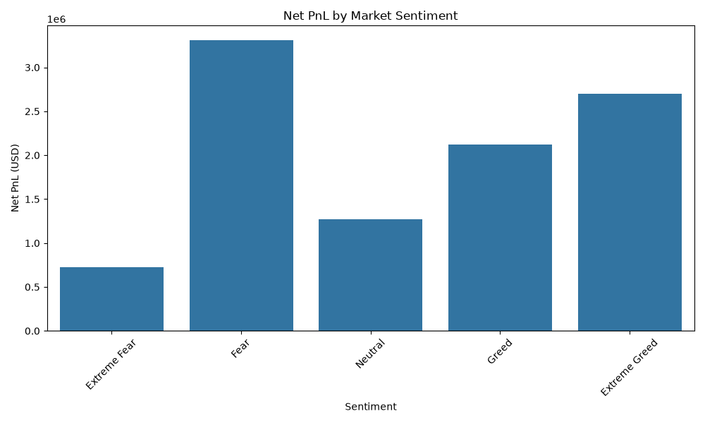
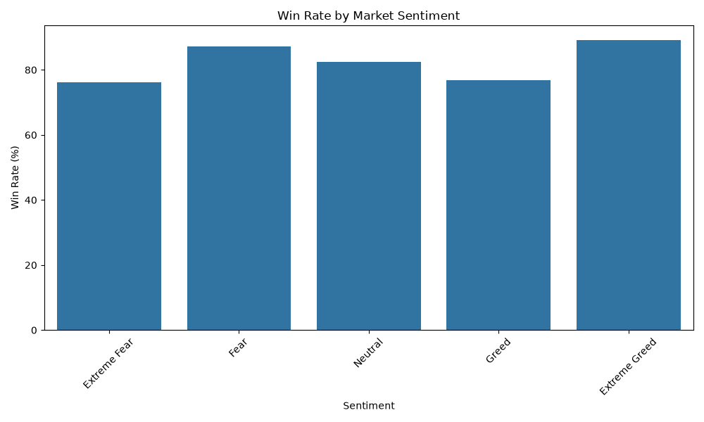
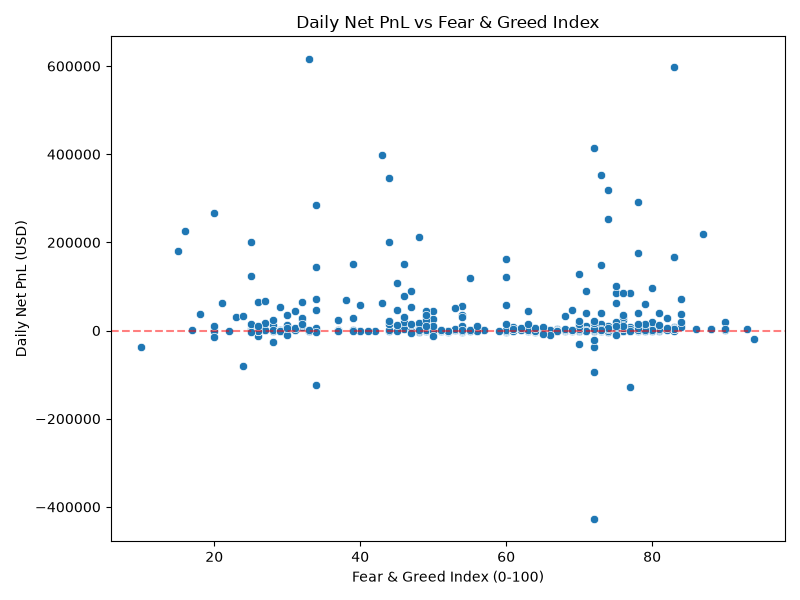

# Market Sentiment & Trader Performance Analysis

This report explores the relationship between a high-performing trader's historical execution data on Hyperliquid and the Bitcoin Fear & Greed Index to discover hidden patterns and formulate smarter trading strategies.

## Executive Summary
After preprocessing and merging over 211,000 trades with historical Fear & Greed Index data, the overall trader performance was evaluated as highly profitable:
- **Win Rate:** 83.20%
- **Net PnL:** $10,051,101.22

## Performance by Market Sentiment

The analysis grouped all realized trades by the market sentiment classification at the time of execution.

### Key Insights
1. **Contrarian Edge During "Extreme Greed"**:
   - The trader achieved their highest win rate (**89.1%**) during Extreme Greed environments.
   - **Hidden Pattern**: Their **SELL/SHORT positions generated $2.51M** in Net PnL during Extreme Greed (with an incredible **90.6% win rate**), compared to just $183k for BUY positions. The trader is highly effective at fading the market when it is overly greedy.
2. **Robustness During "Fear"**:
   - During Fear, the trader was highly profitable on both sides (BUY Net PnL: $1.91M, SELL Net PnL: $1.39M), indicating a strong ability to scalp volatility regardless of direction.
3. **Underperformance in "Extreme Fear"**:
   - Extreme Fear yielded the lowest Net PnL ($726k) and the lowest overall win rate (76.2%). The trader scales back their activity and effectiveness drops when market panic is at its highest.

## Value Correlation

There is a very weak linear correlation (**-0.0786**) between the daily net PnL and the raw 0-100 Sentiment Value. 

> **Actionable Insight**: Do not use the raw 0-100 index value as a linear predictor for sizing. Instead, use the categorical extremes (Fear vs Greed) as directional filters.

## Smarter Trading Strategies Derived

Based on the hidden patterns uncovered, we recommend the following algorithmic trading adjustments:

- **Fade Extreme Greed:** When the index hits "Extreme Greed", heavily skew the strategy towards mean-reversion short selling. The data proves that shorting into extreme greed yields an outsized ~90% win rate.

- **Bi-directional Scalping in Fear:** During standard "Fear" environments, both long and short strategies remain highly effective. Capitalize on the elevated volatility by running market-neutral or high-frequency scalping strategies.

- **Reduce Risk in Extreme Fear:** The trader's edge diminishes during "Extreme Fear". Reduce overall position sizing and tighten stop losses when panic peaks, as the market behaves less predictably.
